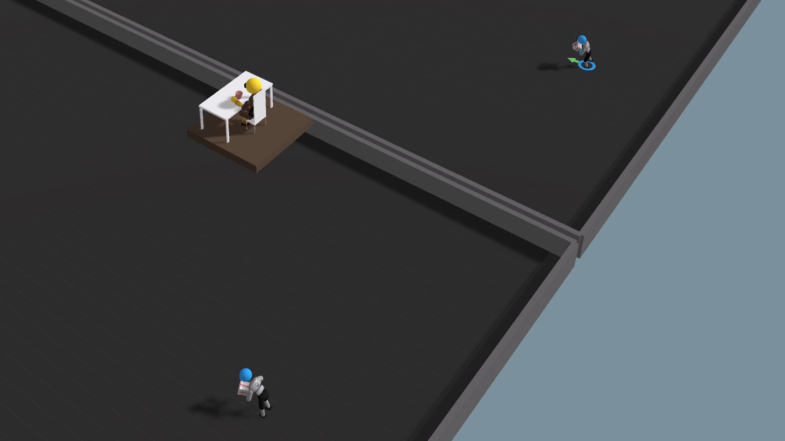

# Heart Engine

Physics-based ragdoll characters trained with reinforcement learning in Unity: walkers that carry gift boxes across the arena, and a seated character holding a mug at a desk. It's built on [Unity ML-Agents](https://github.com/Unity-Technologies/ml-agents) 4.0 and its Walker example.



## What's in this repo

| Path | Contents |
| --- | --- |
| [`WallE-v1/`](WallE-v1/) | The Unity project (Unity **6000.0.57f1**) |
| [`WallE-v1/Assets/ML-Agents/Examples/Walker/Scenes/Walker.unity`](WallE-v1/Assets/ML-Agents/Examples/Walker/Scenes/Walker.unity) | Main scene |
| [`WallE-v1/Assets/ML-Agents/Examples/Walker/Scripts/Khiem.cs`](WallE-v1/Assets/ML-Agents/Examples/Walker/Scripts/Khiem.cs) | Gift-carrying agent: arms and hands are held in a fixed "carry" pose and the torso is lightly locked. The reward favors staying upright and facing the target. |
| [`WallE-v1/Assets/ML-Agents/Examples/Walker/Scripts/Lan.cs`](WallE-v1/Assets/ML-Agents/Examples/Walker/Scripts/Lan.cs) | Seated agent: legs are forced into a chair-sit pose and a mug is attached to the right hand. |
| [`WallE-v1/Assets/ML-Agents/Examples/Walker/TFModels/`](WallE-v1/Assets/ML-Agents/Examples/Walker/TFModels/) | Trained ONNX policies used by the scene |
| [`config/ppo/Walker.yaml`](config/ppo/Walker.yaml) | PPO training config |
| [`results/`](results/) | Configs, final models and logs for each training run (`walk-upright`, `heart-engine-v1` to `v3`). Checkpoints are not included. |
| `ml-agents/`, `ml-agents-envs/`, `com.unity.ml-agents/` | The ML-Agents Python trainer and Unity package (upstream). The Unity project uses the package through a local path. |

## Getting started

### 1. Clone

```bash
git clone https://github.com/HawKhiem/heart-engine.git
```

### 2. Import the third-party assets

The scene uses props and environments from the Unity Asset Store. Their licenses don't allow redistribution, so they aren't in this repo. Get them from the Asset Store and import them into `WallE-v1/Assets/`, keeping their default folder names:

- **Yeongyeongdang**
- **Presents**
- **Mugs, Bowls and Plates**
- **Stylized Snow Forest**

Some models from these packs were also copied into `Assets/ML-Agents/Examples/SharedAssets/`. Only their `.meta` files are committed. Copy the original files back to those paths and Unity relinks the scene automatically:

- `SharedAssets/Presents/`: `present_01.fbx` to `present_08.fbx`, plus their materials in `Materials/`, from the **Presents** pack
- `SharedAssets/Flowers/`: the `SM_*` flower models and `DEMOAtlas_Flowerpack.png` from the flower pack

Without them the agents and training still work, but some props and materials will show as missing (pink).

### 3. Open in Unity

Open `WallE-v1/` with Unity Hub using editor **6000.0.57f1**, then open `Assets/ML-Agents/Examples/Walker/Scenes/Walker.unity` and press Play. The agents run the bundled ONNX models, so no Python is needed for this step.

## Training

Set up the Python side by following the [ML-Agents installation guide](docs/Installation.md). From the repo root:

```bash
python -m venv .venv
# Windows: .venv\Scripts\activate   macOS/Linux: source .venv/bin/activate
pip install -e ./ml-agents-envs -e ./ml-agents

mlagents-learn config/ppo/Walker.yaml --run-id=heart-engine-v4
```

Press Play in the Unity editor when prompted. To continue from an earlier run, add `--initialize-from=heart-engine-v3`. Watch training with:

```bash
tensorboard --logdir results
```

After training, copy `results/<run-id>/Walker.onnx` into `TFModels/` and assign it to the agent's **Behavior Parameters → Model**.

## Credits

Built on the [Unity ML-Agents Toolkit](https://github.com/Unity-Technologies/ml-agents) (Apache 2.0). See [LICENSE.md](LICENSE.md) and [Third Party Notices.md](Third%20Party%20Notices.md). The upstream ML-Agents documentation is in [`docs/`](docs/).
